# Verifying Autonomous Spacecraft Proximity Operations with Observation-Guarded Hybrid Systems

Artifact and scenario models

Companion artifact for *Verifying Autonomous Spacecraft Proximity Operations with Observation-Guarded Hybrid Systems*
(Alex Yuan, Kristina Miller, Sayan Mitra; submitted to TACAS 2027). It pins the exact code that produced the paper's results and
lets every row of the results table be re-run with one command.

The paper verifies autonomous proximity operations (APO), in which a deputy spacecraft closes on a chief, under the sensor suite
that real missions use: a ground station, an angles-only camera, and a proximity sensor that become available at different ranges
and drive the switching between control modes. Two extensions of hybrid-system verification make this possible, both implemented
in the [Verse](https://github.com/AutoVerse-ai/Verse-library) library:

* **Observation-guarded hybrid systems**: automata whose discrete transitions are guarded by an observation produced by a sensor
  function of the joint state of all agents, so a sensor can be changed without rederiving the controller's guards.
* **The sensor parser**: reachability over such a model must evaluate the sensor on sets; the parser lifts a sensor written as a
  composition of primitives to a set-valued operator automatically, and preserves the circular structure of angles so that a
  bearing straddling the ±π cut does not collapse to the whole range.

With these, docking, avoidance, multi-spacecraft tracking, and coordinate-free rendezvous scenarios in joint state spaces of 8 to
54 dimensions are verified against mission requirements, in seconds to about an hour on a laptop.

Reliable Autonomy Group, University of Illinois Urbana-Champaign. Code of the Verse library and of this artifact is under the
University of Illinois/NCSA Open Source License (see `LICENSE`).

## At a glance

<p align="center">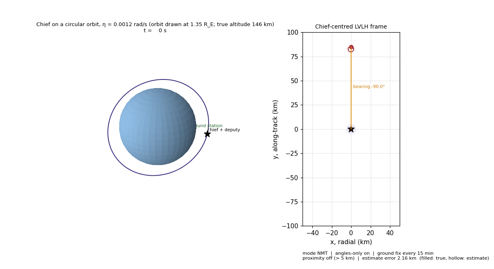</p>

*One simulated run of the docking mission. Left: the chief on a circular orbit (drawn above the globe for visibility; the model's
mean motion puts it at 146 km altitude) with the ground station on the rotating Earth and its update beam every 15 minutes.
Right: the chief-centred LVLH frame with the deputy's true position (filled), its estimate (hollow), the angles-only line of sight
to the chief, and the 5 km proximity zone, which turns active with one-second updates at the end. Rendered by
`scripts/make_orbit_gif.py`.*

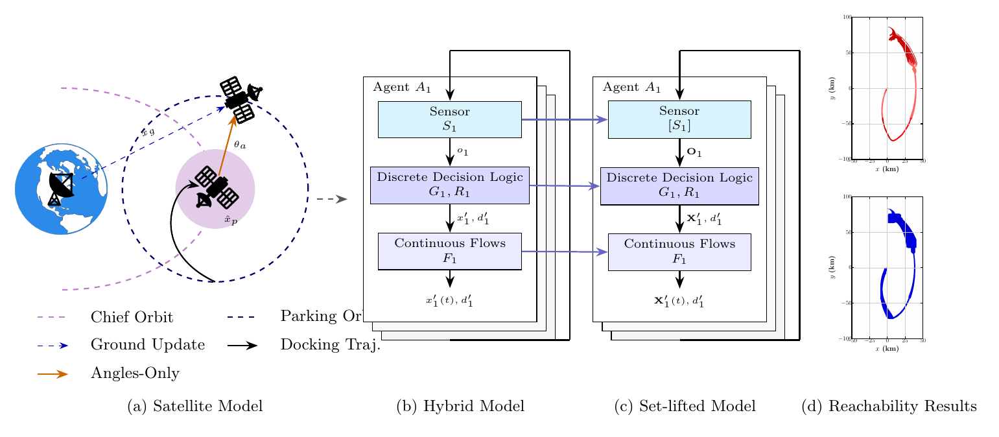

*Figure 1 of the paper: (a) the APO mission geometry with ground updates, angles-only bearings, and the proximity sensor;
(b) the hybrid model used for point-valued simulation, whose discrete logic reads observations produced by the sensor function;
(c) the same model lifted to sets, where the sensor parser turns the sensor into a set-valued operator and Verse lifts guards,
resets, and flows; (d) the resulting reachability analysis (blue) against nominal simulations (red).*

<table>
<tr>
<td align="center">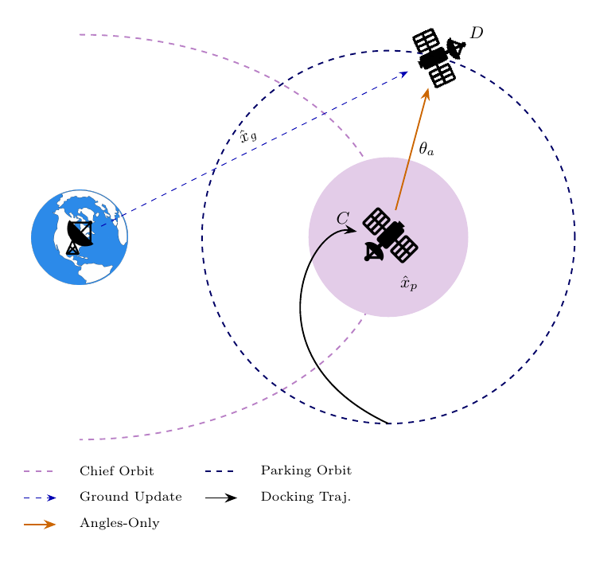<br><em>Docking geometry: deputy on a parking orbit, chief at the origin, ground station updates, angles-only bearing, proximity sensing inside the shaded zone.</em></td>
<td align="center">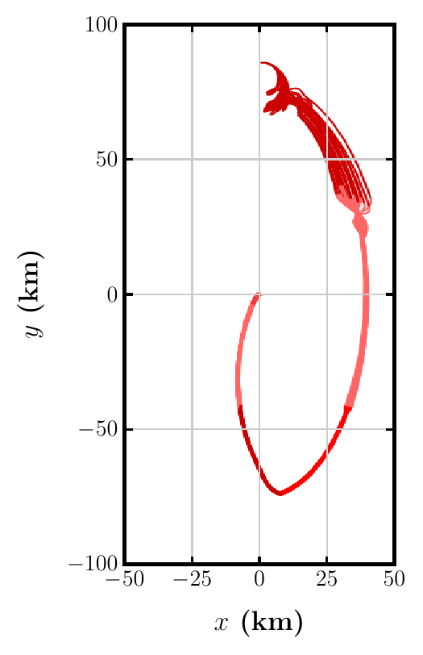 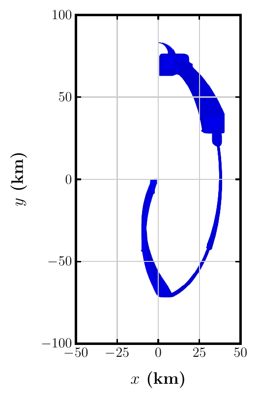 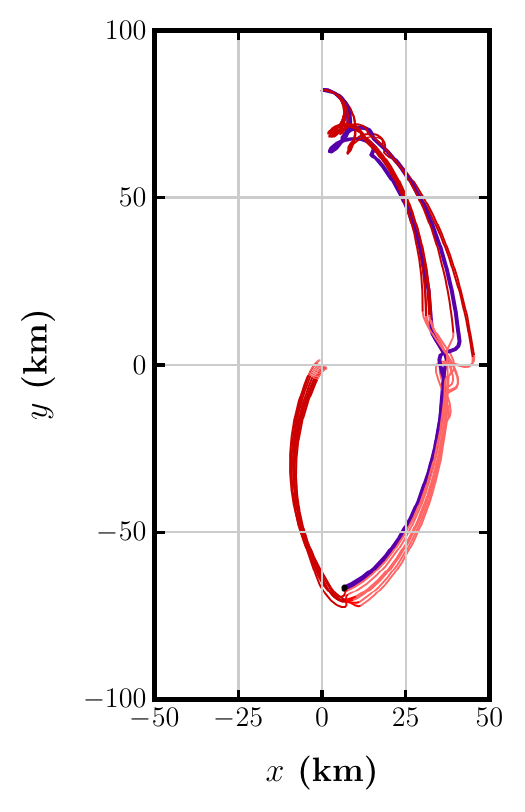<br><em>Docking, x–y plane in km. Left: 25 nominal simulations (0.5 km ground noise, 15 min updates). Middle: the verified reachable set. Right: the degraded configuration (1.25 km, 20 min); the purple trace enters Docking with its estimate outside the mode-entry box.</em></td>
</tr>
</table>

<table>
<tr>
<td align="center">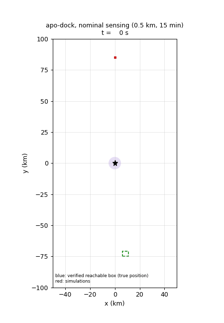<br><em>Nominal sensing: the verified reachable box of the true position (blue) advances with eight simulated deputies (red) inside it; the green dashed box is the mode-entry box B on the estimate.</em></td>
<td align="center">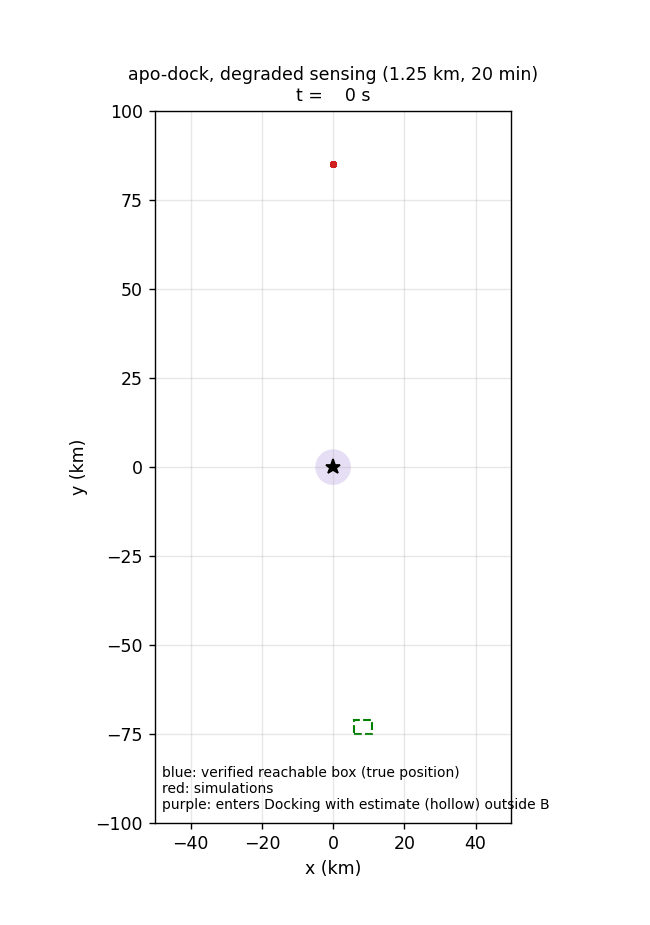<br><em>Degraded sensing (1.25 km, 20 min): the purple deputy enters Docking with its estimate (hollow square) outside B while its true position (filled square) is 5 km away, the witness that turns the inconclusive box check into a violation.</em></td>
</tr>
</table>

<sub>Both animations are produced by <code>scripts/make_docking_gif.py</code> from the saved trees and fresh simulations.</sub>

<table>
<tr>
<td align="center">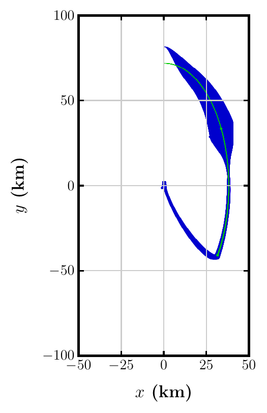<br><em>Verse</em></td>
<td align="center">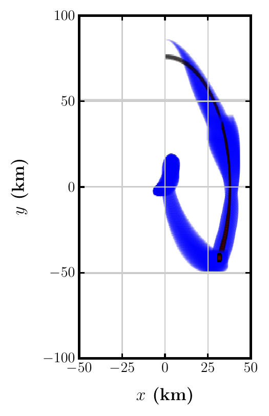<br><em>JuliaReach</em></td>
<td align="center">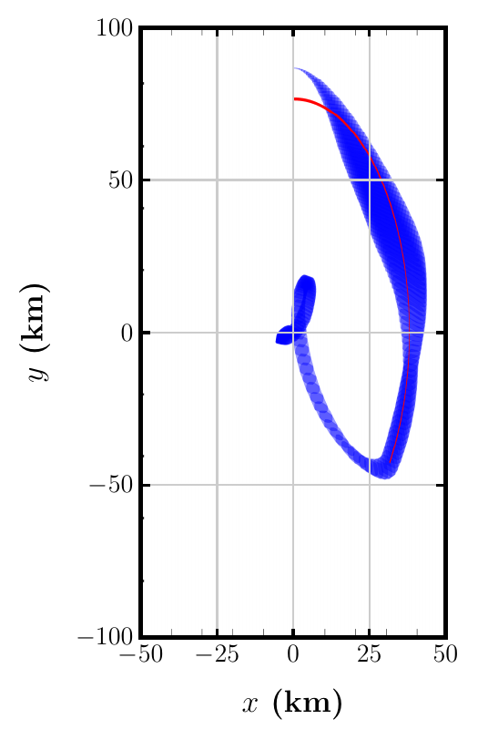<br><em>CORA</em></td>
<td><em>Simplified docking model with time-based guards, the shared baseline of Section 5.4: Verse 26.7 s, JuliaReach 43.7 s, CORA 716 s (Alex Yuan's machine); Verse 12.5 s on an Apple M2 (<code>tools-baseline</code>).</em></td>
</tr>
</table>

## Results table (Table 2 of the paper)

Base rows are the submission's numbers; rows naming a constant change that one constant from the base values
(ground-noise radius 0.5 km, update period 15 min, initial estimation error bound 2.5) and were run for the revision on an Apple M2.
A/I and F/I are the average and final L1-diameter of the reachable set relative to the initial set; the Sim columns are the same
ratios on envelopes of 25 random simulations.

| Scenario | n | Runtime (s) | A/I | F/I | A/I Sim | F/I Sim | Verdict |
|---|---:|---:|---:|---:|---:|---:|---|
| apo-dock | 18 | 4455.17 | 0.70 | 0.73 | 0.30 | 0.04 | verified |
| apo-dock, T_g = 10 min | 18 | 665.16 | 0.63 | 0.81 | 0.22 | 0.00 | verified |
| apo-avoid | 24 | 125.01 | 0.66 | 0.58 | 0.53 | 0.11 | verified |
| apo-avoid, ε_g,max = 0.25 km | 24 | 101.16 | 0.60 | 0.50 | 0.39 | 0.05 | verified |
| apo-avoid, T_g = 10 min | 24 | 101.44 | 0.59 | 0.62 | 0.43 | 0.00 | verified |
| apo-track-2 | 36 | 279.29 | 0.75 | 0.79 | 0.35 | 0.15 | inconclusive |
| apo-track-2, \|e⁰\| ≤ 1 | 36 | 158.88 | 0.47 | 0.55 | 0.23 | 0.14 | verified |
| apo-track-3 | 54 | 670.37 | 0.87 | 0.82 | 0.43 | 0.14 | inconclusive |
| apo-track-3, \|e⁰\| ≤ 1 | 54 | 490.41 | 0.75 | 0.82 | 0.32 | 0.14 | verified |
| rdv-2 | 8 | 4.57 | 4.76 | 24.12 | 1.76 | 1.31 | verified |
| rdv-3 | 12 | 215.88 | 286.40 | 1248.03 | 1.039 | 0.00 | inconclusive |

Verdicts: *verified* when the containment or emptiness check holds on the computed sets; *violated* when a concrete trajectory
witnesses the failure; *inconclusive* when the over-approximation meets the unsafe set and no witness is available.

**What the results show**, beyond the verdicts (the paper's lessons for multi-agent verification):

1. Verification time is governed by the density of discrete transitions, not by the dimension of the joint state space: the
   three-agent scenario at 54 dimensions verifies in less time than the single-agent docking maneuver whose proximity sensor
   fires every second.
2. What limits certification is the precision of the agents' state estimates, and the conservatism of the lifted observation
   accumulates across agents: the multi-agent scenarios return inconclusive under nominal sensing and verify once the initial
   estimate is tightened (the `|e⁰| ≤ 1` rows).
3. Keeping the requirement on the true joint state separate from the condition on an agent's own estimate localizes failures,
   and sweeping the sensing parameters turns a verdict into an envelope of sensor quality: for docking the goal holds throughout,
   while the entry condition is verified at 10 and 15 minute update periods, inconclusive at 0.75 km noise or a 20 minute period,
   and violated with a simulated witness at 1.0 km (see `expected_results.md`).

## What is pinned

| component | where | pinned at |
|---|---|---|
| Verse (hybrid-system reachability library, here with observation-guarded transitions, the sensor parser, and `verify_partitioned`) | submodule `verse/` → [AutoVerse-ai/Verse-library](https://github.com/AutoVerse-ai/Verse-library) | tag `tacas27-sensor-programs` (commit 6a6c87a, branch `satellite_models`) |
| auto_LiRPA (CROWN bound propagation), Alex Yuan's fork with the Verse bridge | submodule `auto_LiRPA/` → [IllinoisReliableAutonomyGroup/auto_LiRPA](https://github.com/IllinoisReliableAutonomyGroup/auto_LiRPA) | commit 711153a |
| Python packages | `requirements-pinned.txt` | versions of the run environment (torch 2.3.1 CPU, cvxpy 1.6.6, highspy 1.11.0, numpy 1.26.4, …) |

The spacecraft models (dynamics, controllers, sensor programs, run scripts) live in `verse/demo/aprod/`; the four paper runs are in
`verse/demo/aprod/paper/`. `prepare.sh` applies two small fixes to the submodule's working tree (see "Known quirks").

## Quick start

Docker (Linux x86-64 or arm64; ~10 minutes to build, CPU only):

```sh
git clone https://github.com/IllinoisReliableAutonomyGroup/spacecraft-autonomous-rendezvous-proximity-operations.git
cd spacecraft-autonomous-rendezvous-proximity-operations
git submodule update --init          # not --recursive: the auto_LiRPA fork references a nested submodule without a URL
docker build -t sensor-programs .
docker run --rm -it -v "$PWD/out:/workspace/out" sensor-programs bash run_row.sh rdv-2        # 10 s smoke test
docker run --rm -it -v "$PWD/out:/workspace/out" sensor-programs bash run_row.sh apo-avoid    # ~2 min
docker run --rm -it -v "$PWD/out:/workspace/out" sensor-programs bash run_row.sh apo-dock     # ~20 min on a laptop
```

Native (macOS or Linux, Python 3.10 or 3.11):

```sh
git clone https://github.com/IllinoisReliableAutonomyGroup/spacecraft-autonomous-rendezvous-proximity-operations.git
cd spacecraft-autonomous-rendezvous-proximity-operations
bash env/native.sh python3.10            # runs `git submodule update --init` itself            # creates ./venv and prepares the submodule
VENV=./venv bash run_row.sh rdv-2
```

`run_row.sh <row>` sets the scenario's constants for that row, runs the verification headlessly (no plot windows), saves the
reachable-set tree to `out/<row>/tree_0.json`, and evaluates the row's property. Row ids and expected numbers: `expected_results.md`.
Full table reproduction, sequentially on a laptop, takes about 2.5 hours; the docking rows dominate.

## Layout

`make smoke` runs the two fast rows, `make all` the whole table, `make sensitivity` the Section 5.3 configurations; the
GitHub Actions workflow builds the Docker image and runs the smoke rows on every push.

```
run_row.sh            one table row or sensitivity configuration, end to end
prepare.sh            fixes applied to the Verse submodule working tree (idempotent)
scripts/
  run_verse_headless.py   runs a Verse demo script without plot windows and saves every verified AnalysisTree
  verdicts.py             docking checks: goal containment on every leaf; entry box vs the mode-entry box B
  pair_separation.py      certified minimum separation between two agents over a tree
  sim_docking_terminal.py 20-run simulation probe (terminal states, entry estimates; the witnesses of Section 5.3)
  sim_docking_baseline.py / sim_ra_baseline.py   A/I Sim and F/I Sim baselines (N = 25)
  var_switch2_ie10.py / var_switch3_ie10.py      switch-track variants with initial estimation error 1.0
  variant_rows.py         turns variant outputs into table rows
results/              trees (gzipped JSON), runtimes, diameters, verdict and simulation JSON from the runs behind the paper
expected_results.md   per-row expected values, verdict rules, tolerances
env/native.sh         native environment setup
Dockerfile            reproduction image
```

## Scenarios and properties checked

The paper's four scenario families and their ids here: docking (`apo-dock`), avoidance of an obstacle (`apo-avoid`),
multi-spacecraft track switching (`apo-track-2`, `apo-track-3`), and coordinate-free rendezvous of bearing-only agents (`rdv-2`,
`rdv-3`). Each is checked against a mission requirement on the true joint state; the docking scenario also checks a condition on the
deputy's own estimate, which is where the sensing pipeline bears on the result.

* `apo-dock`: goal containment, every leaf of the execution tree (branch ended by the 100 m stop rule or by the horizon) lies
  within ε_G = 10 km of the chief; mode-entry condition, the estimated position at the Docking transition lies in
  B = [6, 11] × [−75, −71] km. Verified if both hold on the computed sets; violated if a simulated run witnesses an entry outside B;
  inconclusive otherwise.
* `apo-avoid`: the deputy never comes within 2.5 km of the obstacle (certified minimum box-to-box separation ≥ 2.5 km).
* `apo-track`: deputies never come within 5 km of each other.
* `rdv`: every agent reaches `Complete` by the horizon within 3.1 m of its partner, and no two agents come within 1 m.

## Artifact evaluation (TACAS 2027)

* **Badges applied for:** Available, Functional, Reusable.
* **Artifact:** this repository, github.com/IllinoisReliableAutonomyGroup/spacecraft-autonomous-rendezvous-proximity-operations, and
  the self-contained archive `artifact-selfcontained.zip` attached to its `v1.0-ae` release (submodules vendored, no git history, 108 MB);
  the archival copy is on Zenodo (DOI to be added here when the deposit is published).
* **Extra requirements:** none. x86-64 or arm64 Linux or macOS, Docker or Python 3.10/3.11, about 4 GB of disk for the image, and network
  access during the image build for the pinned Python packages. No GPU, no proprietary software.
* **Smoke test, about 6 minutes:** `git submodule update --init --depth 1 && docker build -t sensor-programs .` (2 to 3 minutes), then
  `docker run --rm -v "$PWD/out:/workspace/out" sensor-programs bash run_row.sh rdv-2` (10 s) and `... run_row.sh apo-avoid` (2 min).
  Expected: the reach-avoid row prints a certified separation of 2.75 km, the rendezvous row completes with every leaf in `Complete`;
  both match `expected_results.md`. Natively: `bash env/native.sh python3.10` then `make smoke`.
* **Full reproduction:** `make all` re-runs every row of Table 2 (about 2.5 hours on a laptop; the docking rows dominate), and
  `make sensitivity` the configurations of Section 5.3 (about 2 hours). `expected_results.md` maps every row and every sensitivity
  claim to the command that produces it, with the expected numbers and the tolerance to expect from the sampled bloating.
  The CORA and JuliaReach sides of the cross-tool comparison are not included; the Verse side is (`tools-baseline`).
* **Reuse:** `run_row.sh` is a template for new rows (one `case` entry sets the scenario's constants), `scripts/verdicts.py` and
  `scripts/pair_separation.py` evaluate any saved tree, and the scenario models under `verse/demo/aprod/` are ordinary Verse scenarios.

## Tested on

* Native path on macOS 15 (Apple M2, Python 3.10, 2026-10-10): fresh clone, `git submodule update --init --depth 1`,
  `prepare.sh`, then `run_row.sh rdv-2` and `run_row.sh apo-avoid` reproduced the expected verdicts and numbers.
* Docker path on GitHub's `ubuntu-latest` runner (x86-64, CPU only), by the `smoke` workflow on every push: image build plus the
  same two rows, with the reach-avoid certified separation checked against `expected_results.md`. Green as of 2026-10-11.

## Known quirks (handled by `prepare.sh` and `run_row.sh`)

* Three paper scripts have `scenario.verify` commented out in the committed branch (the authors last ran them for simulation
  plots); `prepare.sh` re-enables the call and defines the timer the following print uses.
* The 3-agent rendezvous script prints A/I and F/I with `diam_0 = 0.4`; the paper's row uses the initial width of that script,
  `0.04`, hence 286.40 / 1248.03 in the paper versus 28.64 / 124.8 printed.
* The MPC in the docking and reach-avoid agents solves with HiGHS (`cvxpy` + `highspy`). Without `highspy` the docking agent
  silently falls back to LQR and prints "MPC was unable to find a solution" on every step; the numbers then do not reproduce.
  Both packages are in `requirements-pinned.txt`.
* Clone without `--recursive`: Alex Yuan's auto_LiRPA fork records a nested submodule (`jax_guam`) with no URL, which makes a
  recursive clone fail; `git submodule update --init` (one level) is what the setup needs. For a faster fetch of the 250 MB Verse
  history use `git submodule update --init --depth 1`.
* Scripts must run from the Verse root with `demo/aprod` on `sys.path` and the script's own directory first, which the runner does.
* Parallel runs need separate checkouts: the parser cache (`demo/aprod/parsed_wrap/parse_cache/`) and the MPC reference file
  (`demo/aprod/refs.pkl`) are repo-relative and cleared at the start of every script.
* The CORA and JuliaReach models of the cross-tool comparison (Section 5.4) are not part of this artifact; only the Verse side
  (`tools-baseline`) is.

## Citation

If you use this artifact, cite the paper and the Verse library it extends:

```
@inproceedings{yuan2027sensorprograms,
  author    = {Alex Yuan and Kristina Miller and Sayan Mitra},
  title     = {Verifying Autonomous Spacecraft Proximity Operations with Observation-Guarded Hybrid Systems},
  booktitle = {Tools and Algorithms for the Construction and Analysis of Systems (TACAS 2027)},
  year      = {2027},
  note      = {Submitted}
}
```

Verse (the reachability library) and DryVR (its continuous post):

```
@inproceedings{li2023verse,
  author    = {Yangge Li and Haoqing Zhu and Katherine Braught and Keyi Shen and Sayan Mitra},
  title     = {Verse: A {Python} Library for Reasoning About Multi-agent Hybrid System Scenarios},
  booktitle = {Computer Aided Verification (CAV 2023)},
  editor    = {Constantin Enea and Akash Lal},
  series    = {Lecture Notes in Computer Science},
  volume    = {13964},
  pages     = {351--364},
  publisher = {Springer},
  address   = {Cham},
  year      = {2023},
  doi       = {10.1007/978-3-031-37706-8_18}
}

@inproceedings{dryvr,
  author    = {Chuchu Fan and Bolun Qi and Sayan Mitra and Mahesh Viswanathan},
  title     = {{DryVR}: Data-Driven Verification and Compositional Reasoning for Automotive Systems},
  booktitle = {Computer Aided Verification (CAV 2017)},
  editor    = {Rupak Majumdar and Viktor Kun{\v{c}}ak},
  series    = {Lecture Notes in Computer Science},
  volume    = {10426},
  pages     = {441--461},
  publisher = {Springer},
  address   = {Cham},
  year      = {2017},
  doi       = {10.1007/978-3-319-63387-9_22}
}
```
